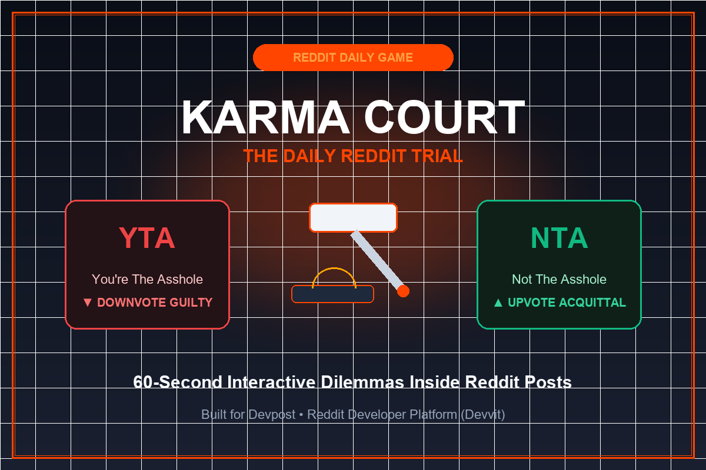

# ⚖️ KarmaCourt: The Daily Reddit Trial

> **Built for Reddit's Game of the Day Hackathon on Devpost**  
> An interactive daily courtroom puzzle game running 100% natively inside Reddit posts.



---

## 🌟 Overview
**KarmaCourt** transforms Reddit's most passionate pastime into an addictive daily detective puzzle game. Every 24 hours, players step into the jury box to investigate evidence, uncover smoking-gun contradictions, and deliver justice on viral community dilemmas.

- 🚨 **The Daily Allegation:** A fresh real-world case drops every 24 hours at 00:00 UTC.
- 🗂️ **Interactive Evidence Locker:** Tap to inspect **Exhibit A**, **Exhibit B**, and the **Smoking Gun** exhibit before casting judgment.
- 🗳️ **Jury Verdict:** Deliver your ruling (**YTA**, **NTA**, **ESH**, or **NAH**).
- ⚖️ **Grand Jury Accord:** Instant comparison against the global Reddit consensus and rationale breakdown.
- 🔥 **Daily Streak Engine:** Track your consecutive days on the jury bench with live countdown timers.
- 📋 **Detective Scorecard:** 1-click copyable Wordle-style evidence summary for Reddit comments.

---

## 🛠️ Tech Stack
- **Framework:** [Reddit Developer Platform (Devvit)](https://developers.reddit.com/)
- **Language:** TypeScript
- **State & Storage:** Devvit Redis Key-Value Store
- **UI:** Native Devvit Block JSX (`@devvit/public-api`)
- **CI/CD:** GitHub Actions Automated Typecheck & Test Suite

---

## 🚀 Local Quickstart & Testing

### 1. Prerequisites
Ensure you have Node.js 18+ and the Devvit CLI installed:
```bash
npm install -g devvit
```

### 2. Login to Reddit Developer Platform
```bash
devvit login
```

### 3. Run Playtest in a Test Subreddit
Navigate to this project folder and run:
```bash
devvit playtest r/YourTestSubreddit
```
This deploys the app to your test subreddit instantly so you can review evidence, vote, and watch the live courtroom in action!

---

## 📁 Repository Structure
```text
karmacourt/
├── src/
│   ├── main.tsx              # Interactive Evidence Locker & Verdict Engine
│   └── data/
│       └── dockets.ts        # Daily cases, evidence exhibits & consensus statistics
├── docs/
│   ├── ARCHITECTURE.md       # Full architecture diagram & technical design
│   ├── DEMO_SCRIPT.md        # 2-minute video pitch & walkthrough script
│   └── VICTORY_MATRIX.md     # Multi-skill competitive analysis
├── devvit.yaml               # Devvit app manifest
├── package.json
└── tsconfig.json
```
