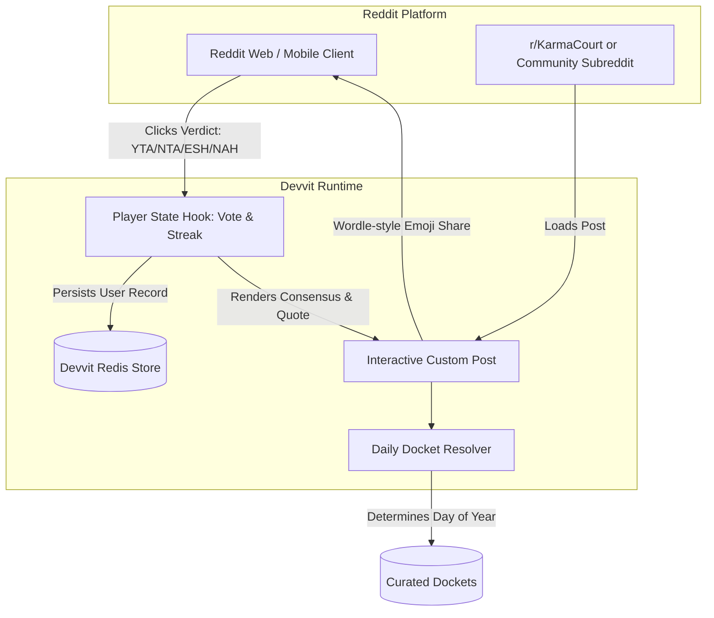

# System Architecture: KarmaCourt

## Core Components
1. **Interactive Post (`src/main.tsx`):** Built with Devvit JSX declarative blocks (`<vstack>`, `<hstack>`, `<button>`, `<text>`). Zero external iframe or external webview required.
2. **Deterministic Daily Engine (`src/data/dockets.ts`):** Syncs all users globally to the same 24-hour case docket based on timestamp.
3. **Verdict Accord Validator:** Evaluates player judgment vs community consensus and renders responsive visual scorecards.
4. **Subreddit Action Menu:** Allows moderators or creators to pin a new trial docket to any subreddit with one click.
